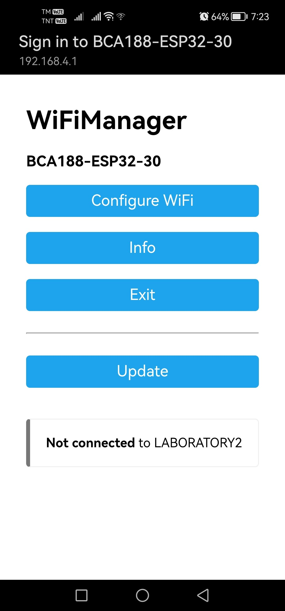
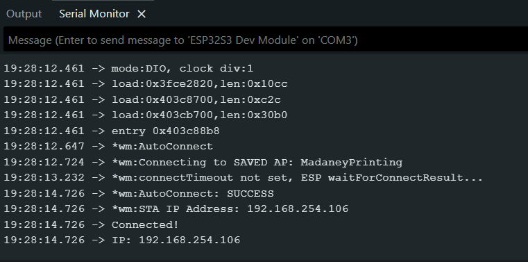

# BCA188 ESP32 Wi-Fi Manager

**Name:** Rabbah Alawi
**Assigned number:** BCA188-ESP32-30

## Results

| Task | What to do | What I observed |
|------|-----------|-----------------|
| 1. Wrong password | Entered a wrong password on the setup page | The connection failed, no IP address was shown, and the setup page came back so I could try again. |
| 2. Reset settings | Held BOOT for 3 seconds while running | Holding BOOT for 3 seconds printed ‘Resetting Wi-Fi settings...’, the board restarted, and BCA188-ESP32-30 appeared again because the saved network was erased. |
| 3. Change the name | Changed name, uploaded, checked phone Wi-Fi list | After uploading, the Wi-Fi list showed the new name BCA188-ESP32-30-TEST instead of the old one. |
| 4. Different network | Reset, then connected to phone hotspot | After the reset, I connected the board to my phone hotspot. The Serial Monitor showed a new IP address, 192.168.4.1, different from the earlier 192.168.254.106. |

## Screenshots

## Explanation

The board connected to a different network without a code change because
WiFiManager saves the Wi-Fi name and password in the ESP32's memory, and
they can be erased and re-entered through the setup page instead of being
hardcoded in the program.
